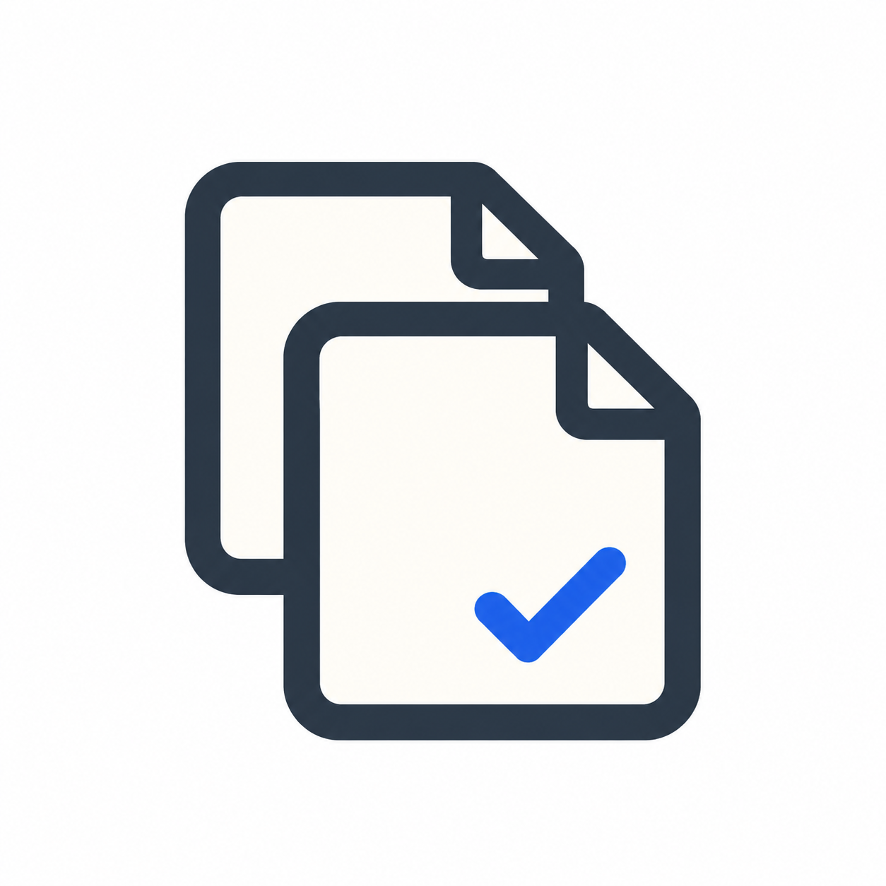

<p align="center">
  <picture>
    <source media="(prefers-color-scheme: dark)" srcset="assets/icon-dark.png">
    
  </picture>
</p>

# Skill Builder

Create an AI skill for a recurring task, or improve an existing one.

**Example: a skill for project handoffs**

> **Notes:** “Launch Tuesday. Maya sends the customer email. Luis checks rollback. Support coverage is undecided.”
>
> **A skill built for this task could produce:**
>
> - **Decision:** launch Tuesday.
> - **Action:** Maya — send the customer email.
> - **Action:** Luis — check rollback.
> - **Open question:** who covers support?

*Illustrative task and output, not a recorded run.*

[Try it](#try-it) · [Get started](#get-started) · [Get help](#get-help) · [Update or remove](#update-or-remove) · [Technical details](#technical-details)

---

<a id="start-with-a-task"></a>
<a id="what-it-does"></a>

## Try it

### Choose a task

**Create** and **Audit** are modes of the same skill, not separate installations.

| I want to… | Choose | What I receive |
| --- | --- | --- |
| Turn a recurring task into a reusable skill | Create | A candidate skill, examples, evaluation plan, and remaining decisions |
| Find worthwhile improvements in an existing skill | Audit | Evidence-linked findings, coverage limits, and a prioritized plan |
| Understand a design choice | Explain | An answer grounded in the preserved knowledge base and applicable sources |

### Prompt examples

**In Codex after installation:**

```text
$skill-builder skill-builder-create
Create a skill that turns project handoff notes into decisions, actions,
owners, and open questions. Use these notes as an example:

Launch Tuesday. Maya sends the customer email.
Luis checks rollback. Support coverage is undecided.
```

**In the ChatGPT tab of a compatible desktop app:** type `@` and select the installed Skill Builder entry, then paste:

```text
skill-builder-create
Create a skill that turns project handoff notes into decisions, actions,
owners, and open questions. Use these notes as an example:

Launch Tuesday. Maya sends the customer email.
Luis checks rollback. Support coverage is undecided.
```

The ChatGPT tab uses `@`; the Codex tab/app uses `$skill-builder` or its skill picker (`/skills` in the CLI). Choose the actual menu entry. If it is missing, start with [setup help](#get-started).

<details>
<summary>More prompt examples: audit a skill or ask a question</summary>

**In Codex:** replace the bracketed path with your skill's location.

```text
$skill-builder skill-builder-audit
Audit the skill in [skill directory]. It summarizes customer-support
tickets, but sometimes drops the requested next action. Recommend fixes.
```

```text
$skill-builder Should our weekly project handoff be a reusable skill
or a one-off prompt? Explain the trade-offs.
```

</details>

---

<a id="prerequisites-and-local-quick-start"></a>
<a id="download-layout-and-installation-scope"></a>
<a id="github-and-openai-distribution"></a>

## Get started

The full workflow needs a desktop environment with local files and execution tools. A browser chat can guide you to the right setup.

### Ask your AI assistant

**Paste into ChatGPT in your browser:**

```text
Guide me to a supported desktop setup for Skill Builder:
https://github.com/altmn/skill-builder
```

**Paste into Codex or a coding agent with local tools:**

```text
Install Skill Builder for this AI tool globally:
https://github.com/altmn/skill-builder
```

### Prefer direct steps?

Use the [installation guide](docs/getting-started.md). Choose the package by purpose:

| Package | Use it for |
| --- | --- |
| [Standalone skill ZIP](https://github.com/altmn/skill-builder/releases/download/v1.0.1/skill-builder-1.0.1.zip) | A host that loads a skill folder; copy only the complete runtime folder |
| [OpenAI plugin ZIP](https://github.com/altmn/skill-builder/releases/download/v1.0.1/skill-builder-1.0.1-plugin.zip) | A compatible desktop plugin import; local execution is required |
| [Source ZIP](https://github.com/altmn/skill-builder/releases/download/v1.0.1/skill-builder-1.0.1-source.zip) | Inspecting, developing, and testing this repository; not a plugin import |

These are the **1.0.1** release assets. [Checksums and release receipts](https://github.com/altmn/skill-builder/releases/tag/v1.0.1) identify them; subsequent source changes are separate. GitHub's automatic source archive is also distinct from an installable package. This project does not claim an approved OpenAI directory listing or a universal browser ZIP importer.

---

## Get help

If Skill Builder does not appear, check the chosen package, installation scope, and the selector for the AI tool you are using. If it appears but cannot complete a task, check local file and execution access.

**Paste into the AI tool where you are trying to use it:**

```text
Help me troubleshoot Skill Builder:
https://github.com/altmn/skill-builder

I'm using [AI tool and surface]. I installed [package or method].
I expected [result], but got [actual result or short error].
Investigate the issue.
```

[Get support](SUPPORT.md) or [report a problem](https://github.com/altmn/skill-builder/issues/new/choose) using a small synthetic example and the relevant version. Keep private skill content out of public reports. Report vulnerabilities through the [security policy](SECURITY.md).

---

## Update or remove

Ask the coding agent that manages your installation.

To update:

```text
Update Skill Builder:
https://github.com/altmn/skill-builder
```

To disable:

```text
Temporarily disable Skill Builder:
https://github.com/altmn/skill-builder
```

To uninstall:

```text
Uninstall Skill Builder:
https://github.com/altmn/skill-builder
```

See [direct update and removal guidance](docs/getting-started.md#update-disable-or-remove). There is no automatic updater; preserve owned-file records and local modifications.

---

<a id="validation-and-evidence"></a>

## Where it works

| Environment | Current position |
| --- | --- |
| Codex with local tools | Primary target. A bounded native CLI panel exercised earlier candidate bytes; comprehensive and exact-release acceptance remain incomplete. |
| ChatGPT desktop with local execution | The plugin declares desktop-only execution. Use a compatible installation route your account offers; native acceptance of the current package is not claimed. |
| ChatGPT in a browser | Setup guidance and planning are useful here; the current plugin's full local-file workflow does not run in an ordinary browser thread. |
| Claude Code, Grok Build, and custom hosts | Adapters are documented. Claude/Grok execution remains unrun; a documented adapter is not a tested support promise. |

Helpers use Python 3.10+. The optional full YAML/schema validation set needs Python 3.11+ and separately installed dependencies. See [compatibility and host guides](docs/compatibility.md), [current validation](validation/README.md), and the [preserved technical/evidence guide](docs/technical-guide.md).

<a id="full-knowledge-preservation"></a>
<a id="effects-trust-boundaries-and-data"></a>
<a id="build-reproducible-archives"></a>

## Technical details

Skill Builder retains its complete source knowledge base and all 99 rule IDs. The archive remains byte-for-byte preserved; applicability still requires judgment. The CLI assists with intake, source retrieval, scaffolds, and static evidence. Its output does not certify usefulness, safety, host support, or readiness to publish.

Ordinary CLI use is offline: it reads explicit local inputs and the bundled archive, and writes the requested output tree. It does not execute audited code, install dependencies, contact accounts, or publish. Share reports only with the intended audience. See [privacy](PRIVACY.md) and the [effects and threat model](docs/effects-and-threat-model.md).

| I want to… | Read this |
| --- | --- |
| Install, verify, update, or remove | [Getting started](docs/getting-started.md) |
| Use the helpers directly | [CLI contract](skills/skill-builder/references/cli.md) · [Technical guide](docs/technical-guide.md) |
| Understand the design and preservation boundary | [Architecture](docs/architecture.md) · [Knowledge-base preservation](docs/technical-guide.md#full-knowledge-preservation) |
| Inspect evaluations and historical evidence | [Evaluation plan](evals/README.md) · [Validation](validation/README.md) · [Technical/evidence guide](docs/technical-guide.md) |
| Build and release reproducible packages | [Technical build steps](docs/technical-guide.md#build-reproducible-archives) · [Release instructions](docs/releasing.md) |

<a id="maintenance-and-release-decisions"></a>

## Contribute

Documentation, examples, and focused improvements are welcome. Start with [CONTRIBUTING.md](CONTRIBUTING.md). Work on a feature branch and open a pull request against `master`; assess Create and Audit propagation separately using the [workflow-impact policy](docs/workflow-impact.md).

For maintainers: [presentation conventions](docs/presentation.md), [changelog](CHANGELOG.md), [submission preparation](docs/chatgpt-submission.md), and [community expectations](CODE_OF_CONDUCT.md). Existing source history, correction records, and failed/incomplete evidence remain linked in the [technical guide](docs/technical-guide.md).

Maintained by [Alex Allen (@altmn)](https://github.com/altmn). [MIT license](LICENSE.md) · [Retained notices](NOTICE.md) · [Terms](TERMS.md). This independent project is not an official OpenAI product.
